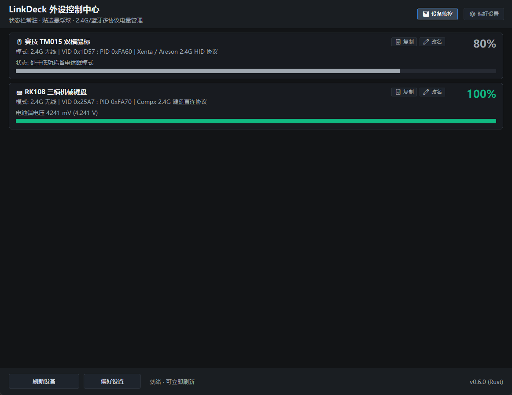
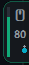
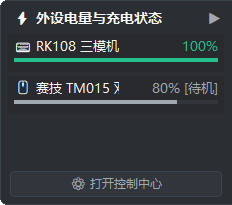
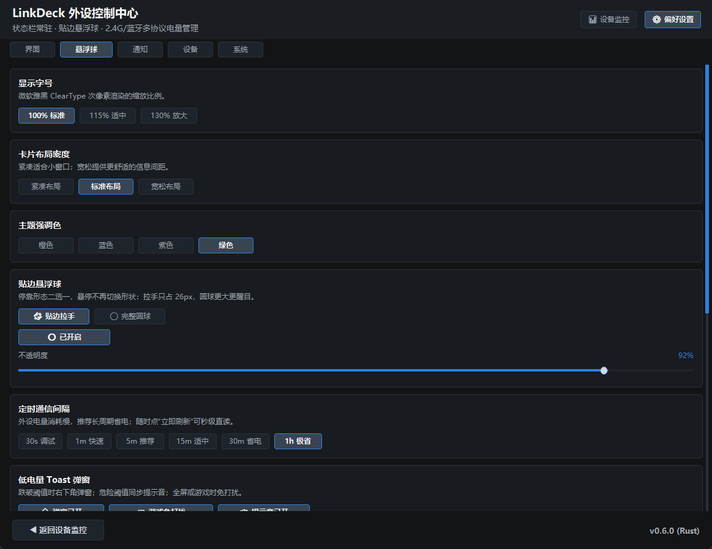
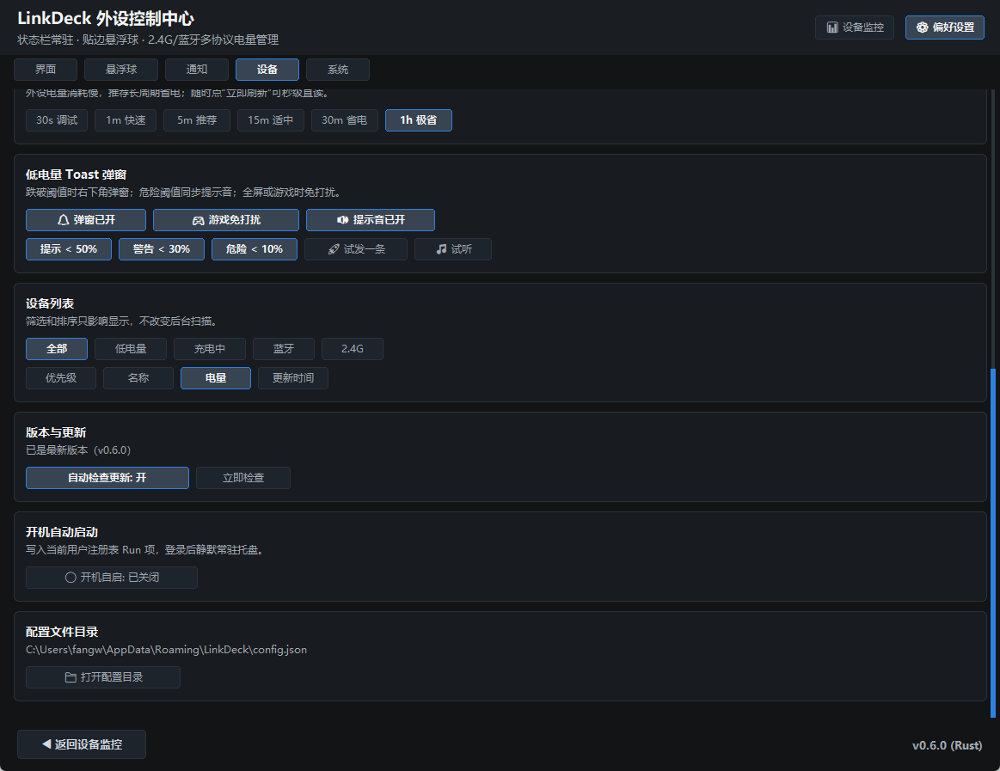

# LinkDeck

**右下角贴边电量悬浮球 + 外设控制中心。** 一个约 2 MB 的 Rust 单文件程序，直连 2.4G 接收器与蓝牙外设，实时读出键盘 / 鼠标 / 耳机的电量与充电状态，免装任何原厂驱动。

- 免安装、免启动原厂臃肿软件（RK Keyboard Software、Saiggi TM015、Synapse……），省下数百 MB 后台内存。
- 单个 exe，无运行时依赖，常驻内存约 11 MB，无控制台闪窗。
- 支持 2.4G 无线接收器、USB 有线、蓝牙三种连接方式，覆盖键鼠 / 耳机 / 手柄。
- 高分屏友好：按系统缩放渲染，微软雅黑 ClearType 次像素抗锯齿，字号可选 100% / 115% / 130%。

<p align="center">
  
</p>

---

## 🎈 界面预览

| 贴边悬浮球 | 展开抽屉 |
| :---: | :---: |
|  |  |
| 26×64 圆角拉手，左侧竖向电量条 | 点击滑出外设卡片，含电量条与充电/待机状态 |

| 偏好设置 · 界面与悬浮球 | 偏好设置 · 通知 / 设备 / 系统 |
| :---: | :---: |
|  |  |

---

## ✨ 功能

### 1. 右下角贴边悬浮球

- **默认开启**，贴附屏幕右下边缘（任务栏上方），不抢焦点、不进任务栏。
- **两种停靠形态**，在 `偏好设置 → 悬浮球` 里二选一：
  - **贴边拉手**（26×64）：左侧两角圆角、右侧齐平压在屏幕边缘，占地只有圆球的一半；
  - **完整能量球**（48×48）：更大更醒目。
  - 悬停**不会**切换形状，避免鼠标在两种轮廓的差集里反复进出导致闪烁。
- **电量直接读**：左侧 3px 竖向电量条按比例灌满，高电量绿（≥ 50%）、中电量橙（20%–49%）、低电量红（< 20%），外圈描边同步染色。
- **充电态**：描边与电量条转为电光青蓝脉冲呼吸光环，图标变为 ⚡。
- **自上而下**：设备图标 ⌨️ / 🖱️ / 🎧、电量数字、轮播指示点；默认 80% 不透明度叠加在桌面上。
- **多外设轮播**：每 3 秒自动平滑切换当前活跃外设；鼠标悬停时滚动滚轮可立即手动切台。
- **随手拖拽**：长按左键沿屏幕边缘上下拖动，松手贴边吸附并记住高度。
- **透明度可调**：滑块 40%–100%，1% 步进，松手才写盘。展开抽屉另有可读性下限，调低也不糊。
- 点击球体滑出抽屉，右上角 `▶` 收回；抽屉底部 `⚙️ 打开控制中心` 直接唤起主面板。

### 2. 控制中心（设备监控）

- 多设备卡片：实时电量进度条、协议类型标注、在线/充电/待机状态。
- 高精度数据：电池端电压（如 `4241 mV (4.241 V)`）、连接模式（2.4G / 有线 / 蓝牙）；复制设备信息时一并带出 VID/PID 与物理路径。
- 悬浮球悬停气泡同样给出电量、充电徽标与毫伏读数。
- 手动刷新有即时的进行中状态与「刷新完成 · N 台设备 · 新增 X · 变化 Y」汇总。
- 卡片可点击选中，支持复制设备信息与重命名（别名持久化到配置）。
- 首次运行有引导面板，说明悬浮球、托盘入口与电量监控流程。

### 3. 偏好设置（分组化）

顶部常驻五组导航，点击直达对应卡片；所有控件坐标由同一份布局结果驱动绘制与点击。

| 分组 | 包含的设置项 |
| :--- | :--- |
| **界面** | 显示字号（100% / 115% / 130%）、卡片布局密度（紧凑 / 标准 / 宽松）、主题强调色（橙 / 蓝 / 紫 / 绿） |
| **悬浮球** | 停靠形态（贴边拉手 / 完整圆球）、悬浮球开关、不透明度滑块（40%–100%） |
| **通知** | 定时通信间隔（30s / 1m / 5m / 15m / 30m / 1h）、低电量 Toast 开关、游戏免打扰、提示音开关、提示 < 50% / 警告 < 30% / 危险 < 10% 三档阈值、`🚀 试发一条`、`🎵 试听` |
| **设备** | 筛选（全部 / 低电量 / 充电中 / 蓝牙 / 2.4G）、排序（优先级 / 名称 / 电量 / 更新时间） |
| **系统** | 版本与更新（自动检查更新开关、立即检查、升级）、开机自动启动、配置文件目录（显示路径 + 一键打开） |

### 4. 低电量提醒

- 电量跌破危险阈值（默认 < 10%）时，右下角 Toast 与「饿死了」语音提示同时触发。
- 同一档位只响一次，充上电自动复位，再次跌破会重新提醒；全屏 / 游戏时可免打扰。
- 音效内置在 exe 里，单文件运行不需要任何外部资源。

### 5. 托盘常驻

- 悬停显示详尽电量气泡；右键菜单包含：外设控制中心、偏好设置、立即刷新、检查/立即升级、悬浮球开关、开机自启、退出。

### 6. 自动更新

启动 10 秒后检查一次 GitHub Releases，之后每 6 小时轮询；下载、校验、自替换、失败回滚全自动，托盘菜单可直接升级。实现细节见 [技术文档](docs/TECHNICAL.md#5-自动更新单一-exe-自替换)。

---

## 🔌 支持的设备

| 品牌 / 方案 | 典型支持型号 | 连接模式 |
| :--- | :--- | :--- |
| **罗技 Logitech** | GPW 1/2/3 代、G502 Lightspeed、G304、G903、M720 Triathlon、G913/G915、MX Master 3/3S 全系（HID++ 2.0/4.0 + 1.0 兼容） | 2.4G / 有线 |
| **雷蛇 Razer** | 毒蝰 Viper V2 Pro / V3 Pro / Ultimate、炼狱蝰蛇 V2/V3 Pro、巴塞利斯蛇全系、眼镜蛇 Cobra Pro、那伽梵蛇、八岐大蛇（OpenRazer 报文） | 2.4G / 有线 |
| **VXE / VGN / ATK** | 蜻蜓 R1 全系、MAD R / MAD R Major+、蜻蜓 F1/F2 系列、ATK F1 / A9 / Zero 8K（双代 Nordic 协议） | 2.4G / 有线 |
| **迈从 MCHOSE** | A5 / A5 Pro / AX5 / A5 V3 / A7 / A7 Ultra / G3 / L7 / M7 / K7 系列（Legacy + Modern 双协议） | 2.4G / 有线 |
| **RK / 狼蛛 / VGN / 新盟 / 珂芝 / 瓦尔基里** | RK108 / F75 / F99 / M75 / R75 / S98 / RK100 / RK87 / RK84 / RK68、狼蛛 F75/F87/F99/SC680、V87 / V98 / S99、新盟 X98 / M71、珂芝 K75 / K98 等（Compx 直读 + 电池放电曲线） | 2.4G / 有线 |
| **赛技 / 黑爵 / 鲨客 / 多彩** | 赛技 TM015、黑爵与鲨客 R1/X3/X6/X11、多彩 M600 Pro 等（Xenta 异步协议） | 2.4G / 有线 |
| **造品 / Scyrox / 达尔优** | 造品 Z2 / Z2 Mini、Scyrox V8、达尔优 A950 / A950 Air / A950 Wing、G-Wolves Lycan、Kysona M600 | 2.4G / 有线 |
| **赛睿 SteelSeries** | Aerox 3/5/9 Wireless、Prime Wireless、Rival 650、Apex Pro 无线键盘、Arctis 7 / 9 / Pro / Nova 系列耳机 | 2.4G / 有线 |
| **华硕 ASUS ROG / TUF** | 龙鳞 Ace、月刃 Keris、战刃 Gladius III、夜魔 Azoth、魔导士 Falchion、Claymore II 等（支持 Omni 接收器） | 2.4G / 有线 |
| **美商海盗船 Corsair** | 暗影 Dark Core RGB Pro/SE、卡特 Katar Pro、铁爪 Ironclaw、圣剑 Sabre、K70 PRO Mini、K100 AIR、HS70/80 耳机 | 2.4G / 有线 |
| **客制化键盘（QMK/VIA）** | Keychron、NuPhy、WOB 雨75、桥75、魔极客 MonsGeek、Hi75 等三模铝坨坨（蓝牙 GATT `0x180F`） | 蓝牙 |
| **全品牌蓝牙外设** | AirPods / 华为 / 索尼 / 漫步者 / Bose 等蓝牙耳机，小米双模 / 罗技 Pebble 等蓝牙鼠标，蓝牙键盘、Xbox 蓝牙手柄 | 蓝牙 |
| **标准 HID 电池规范** | 符合 Windows HID Power / Battery System（`0x0084` / `0x0085`）的第三方外设 | 2.4G / 有线 |

> 各协议的报文格式、VID/PID 覆盖范围与探测机制见 [技术文档 · 协议适配矩阵](docs/TECHNICAL.md#3-协议适配矩阵)。

---

## 📥 安装与使用

1. 从 [Releases](https://github.com/fangweilong/link-deck/releases) 下载 `link-deck.exe`。
2. 双击运行即可，无需安装；程序常驻托盘并显示右下角悬浮球。
3. 首次运行会弹出引导面板，说明悬浮球、托盘入口与支持的外设范围。

配置文件：`%APPDATA%\LinkDeck\config.json`（可在 `偏好设置 → 系统 → 配置文件目录` 打开）。

开机自启：`偏好设置 → 系统 → 开机自动启动`，写入当前用户注册表 `Run` 项，无需管理员权限；程序移动或自更新后路径自动刷新。

### 命令行

```powershell
link-deck.exe --status                  # 查看已扫描并连接的外设电量状态
link-deck.exe --protocols               # 查看内置私有协议支持库清单
link-deck.exe --scan-all                # 枚举全部 HID 设备（用于未识别设备适配）
link-deck.exe --check-update            # 查询是否有新版本
link-deck.exe --download-update --force # 强制下载最新版（修复损坏的安装）
link-deck.exe --apply-update <path>     # 用指定 exe 替换自身并重启
```

### 从源码构建

需要 Rust stable 与 MSVC 工具链：

```powershell
cargo build --release
# 产物：target\release\link-deck.exe
```

也可直接：

```powershell
cargo run --release
```

---

## ❓ 常见问题

**设备没被识别怎么办？**
运行 `link-deck.exe --scan-all`，把输出（UsagePage / Report ID / VID / PID / 物理路径）提交到 Issue，通常补一条协议映射即可。

**悬浮球不见了？**
托盘右键 → 点击「🔘 桌面贴边悬浮球」重新开启。如果只是换了分辨率 / 显示器后位置漂移，退出并重新运行 LinkDeck，它会按当前屏幕重新贴边定位。

**会读取哪些数据、联网吗？**
只读取本机 HID / 蓝牙设备的电量与连接状态；联网仅用于检查 GitHub Releases 更新（可在偏好设置里关闭）。

**装在 `Program Files` 里为什么升级失败？**
自更新需要写入 exe 所在目录，只读目录会给出明确提示；把 exe 放到用户目录（如 `D:\Tools\LinkDeck\`）即可。

---

## 📚 更多文档

- [技术文档：协议原理、自动更新、配置项与诊断](docs/TECHNICAL.md)
